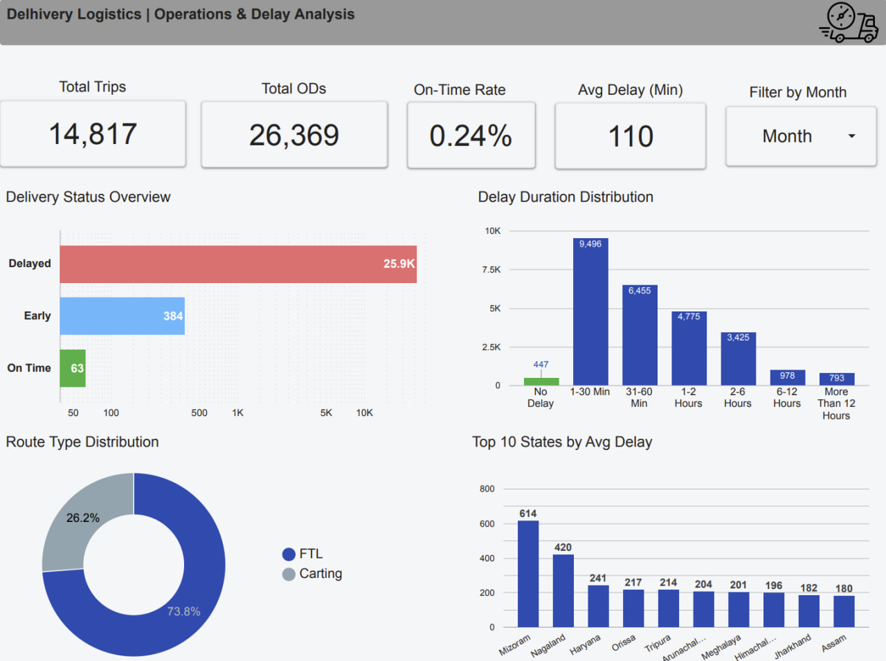

# Delhivery Logistics: Performance & Delay Analysis

**SQL Server · Looker Studio · Data Quality**

A portfolio case study that prepares segment-level logistics records for origin–destination (OD) analysis, then presents route composition and travel-time variance in a Looker Studio dashboard.

**Static preview:** the image opens a screenshot. A public interactive Looker Studio report is not currently linked.

## Business questions

- How many distinct trips and OD movements are represented?
- How does actual travel time differ from the OSRM baseline?
- Which delay ranges and route types account for most movements?
- Which locations warrant further operational investigation?

## Results shown in the original dashboard

| Metric | Dashboard result |
| --- | ---: |
| Distinct trips | 14,817 |
| OD movements | 26,369 |
| Average time variance | 110 minutes |
| FTL / Carting composition | 73.8% / 26.2% |
| Exactly on-baseline movements | 63 (0.24% of OD movements) |

The preview was produced from the original analysis. It has not been regenerated following the SQL maintenance changes in this repository.

## Understand the metrics

- **Grain:** one row per combination of trip, source, destination, OD start, and OD end. A trip can contain multiple OD movements.
- **Delay minutes:** `final_actual_time - final_osrm_time`. OSRM is the comparison baseline; this is not evidence of a missed customer delivery promise or contractual SLA.
- **Status:** positive variance is delayed relative to the baseline; negative variance is early; zero is exactly on baseline. The screenshot’s 0.24% excludes early movements.
- **Missing times:** the SQL labels the delay category `Unknown` instead of assigning it to the longest-delay bucket.
- **Geography:** state-level results require a complete, verified center-to-state lookup. Only four example mappings are published.

## SQL workflow

1. Profile row counts, data types, missing values, and categorical fields.
2. Flag suspicious durations, timestamp ordering, and duplicate records.
3. Preserve raw data and create a working table; standardize text and null negative segment durations.
4. Select an OD record using the highest cumulative actual time, with deterministic tie-breakers.
5. Calculate time variance, percentage variance, delay bands, and date dimensions.
6. Join source and destination centers to a state mapping table.
7. Check missing mappings and duplicate OD keys; expose a reporting view.

The OD selection assumes cumulative actual time increases within a movement. Validate that assumption against the source data before applying the workflow elsewhere. Profiling checks report suspicious records; not every flagged condition is automatically corrected or removed.

## Repository guide

| File | Purpose |
| --- | --- |
| [sql/sql_workflow.sql](sql/sql_workflow.sql) | Documented T-SQL preparation, validation, and reporting view |
| [Looker-Studio/delhivery-logistics-dashboard.png](Looker-Studio/delhivery-logistics-dashboard.png) | Original dashboard screenshot |

## Run and reproduce

1. Use SQL Server 2017 or newer and a client that understands `GO`, such as SSMS.
2. Import the source dataset as `delhivery.delhivery_data`, matching the columns referenced by the script. The raw dataset and import schema are not supplied here.
3. Run the numbered sections in order in a dedicated analysis database. Review the checks before transformation.
4. Supply a complete center-to-state mapping before relying on geographic outputs.
5. Query `delhivery.vw_delivery_analysis` and reconcile row counts, NULLs, and aggregate results.

The script creates working tables. Do not rerun the table-creation sections against existing outputs without reviewing/resetting those derived tables in your own analysis environment. The `CREATE OR ALTER VIEW` statement is isolated in its own batch.

## Interpretation and limitations

Travel-time variance can prioritize route investigations, but it does not identify a causal explanation by itself. Compare volume, distance, route type, and data coverage before drawing operational conclusions.

The source dataset, full geographic mapping, and editable Looker Studio report are not included. The repository therefore documents the transformation approach and published results without claiming that the complete dashboard is reproducible from the supplied files alone.

## Author

**Maged Bin Laswad** · [LinkedIn](https://www.linkedin.com/in/maged-binlaswad-63261726a/)
